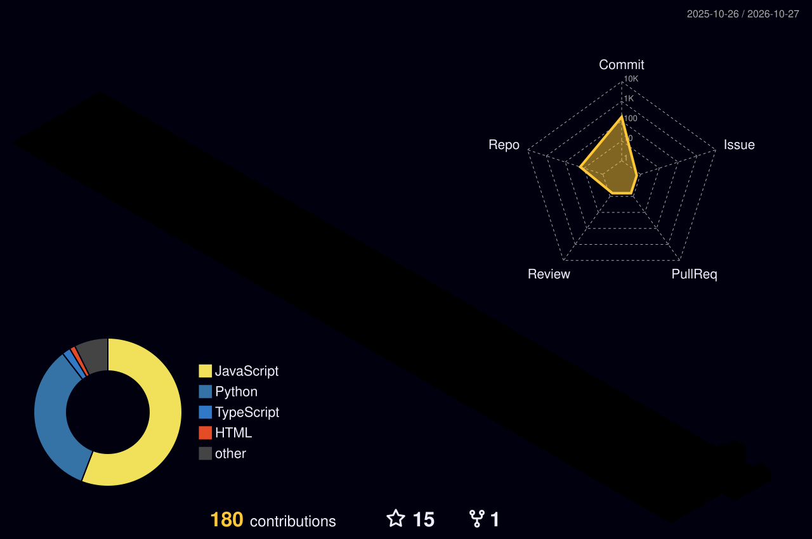

<h1 align="center">William Chou</h1>

  <b>Ever learning, ever refining — ever nearer to the truth.</b> 
  在不断学习中优化系统，追求真理。

---

### 现在在做 In Progress

| 项目 | 做什么 | 栈 |
|---|---|---|
| [w1-quant-board](https://github.com/William-Trader/w1-quant-board) | 量化看板 · 信号与持仓 | JavaScript |
| [naked-k-analysis](https://github.com/William-Trader/naked-k-analysis) | 价格行为 K 线分析 | Python |
| [ashare-financial-report-agent](https://github.com/William-Trader/ashare-financial-report-agent) | A 股财报分析与风险体检 | Python |

### 关注 Watching

<code>价格行为</code> <code>财报口径</code> <code>风险预算</code> <code>自动化交易</code>

### 贡献 Contributes

  

  
  

  

  <picture>
    <source media="(prefers-color-scheme: dark)" srcset="https://raw.githubusercontent.com/William-Trader/William-Trader/output/snake-dark.svg" />
    
  </picture>

